==================

🎓 **EnviroSenseIoT** es una aplicación fullstack de monitoreo ambiental basada en Internet de las Cosas (IoT).  
Implementada sobre el ecosistema Docker, utiliza MicroPython para la programación de microcontroladores, FastAPI para el backend, React para el frontend y MongoDB como base de datos.  
Este proyecto fue desarrollado como Trabajo Final de la Especialización en Internet de las Cosas en la Facultad de Ingeniería de la Universidad de Buenos Aires.

---

## 🧪 Características

- **Monitoreo en tiempo real**: Recopila y visualiza datos ambientales de sensores IoT.
- **Arquitectura modular**: Diseñada para facilitar la expansión y personalización.
- **Interfaz web interactiva**: Construida con React para una experiencia de usuario fluida.
- **Backend robusto**: Implementado con FastAPI, ofreciendo alto rendimiento y escalabilidad.
- **Persistencia de datos**: Utiliza MongoDB para almacenar y consultar datos históricos.

---

## ⚙️ Tecnologías

- **MicroPython** – Programación de microcontroladores.
- **FastAPI** – Backend moderno, rápido y eficiente.
- **React** – Frontend interactivo basado en componentes.
- **MongoDB** – Base de datos NoSQL orientada a documentos.
- **Docker** – Contenedores para despliegue consistente y escalable.

---

## 🚀 Instalación

1. **Clonar el repositorio**:

   ```bash
   git clone https://github.com/martinlacheski/EnviroSenseIoT.git
   cd EnviroSenseIoT
   ```

2. **Construir y levantar los contenedores**:

   ```bash
   docker-compose up --build
   ```

3. **Acceder a la aplicación**:

   Abre tu navegador en la siguiente URL:

   ```
   http://localhost
   ```

---

## 📁 Estructura del Proyecto

```
EnviroSenseIoT/
├── backend/           # API REST con FastAPI
├── frontend/          # Interfaz web en React
├── iot-devices/       # Scripts para microcontroladores (MicroPython)
├── mongo-init/        # Scripts de inicialización de la base de datos
├── tests/             # Pruebas automatizadas
├── docker-compose.yml # Orquestación de servicios con Docker
├── env.template       # Plantilla de variables de entorno
└── README.md          # Este archivo
```

---

## 📌 Uso

Una vez iniciada, la aplicación permite:

- Visualizar datos en tiempo real provenientes de los sensores.
- Consultar registros históricos almacenados.
- Gestionar dispositivos IoT desde una interfaz amigable.
- Configurar parámetros y umbrales de monitoreo ambiental.

---

## 🤝 Contribuciones

¡Las contribuciones son bienvenidas! Para colaborar:

1. Realiza un fork del proyecto.
2. Crea una nueva rama: `git checkout -b feature/mi-mejora`.
3. Realiza tus cambios y haz commit: `git commit -am "Agrega nueva funcionalidad"`.
4. Sube tu rama: `git push origin feature/mi-mejora`.
5. Abre un Pull Request.

---

## 📄 Licencia

El código fuente de este proyecto está licenciado bajo la Licencia MIT. Consulta el archivo [LICENSE](LICENSE) para más información.

La documentación escrita y recursos gráficos están licenciados bajo una Licencia Creative Commons Atribución–NoComercial–CompartirIgual 4.0 Internacional (CC BY-NC-SA 4.0).
Más información: https://creativecommons.org/licenses/by-nc-sa/4.0/

---

## 📬 Contacto

- **Autor**: Martín Lacheski  
- **Correo**: martinlacheski@gmail.com
- **GitHub**: [@martinlacheski](https://github.com/martinlacheski)

---

## 🔗 Recursos Recomendados

- [MicroPython](https://micropython.org/)
- [FastAPI](https://fastapi.tiangolo.com/)
- [React](https://reactjs.org/docs/getting-started.html)
- [MongoDB](https://www.mongodb.com/docs/)
- [Docker](https://docs.docker.com/)

